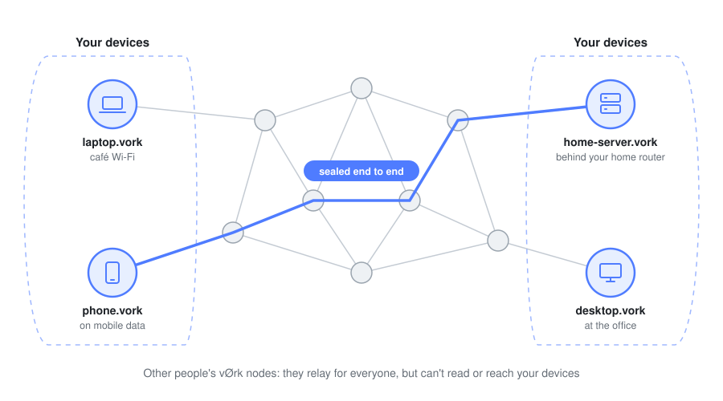
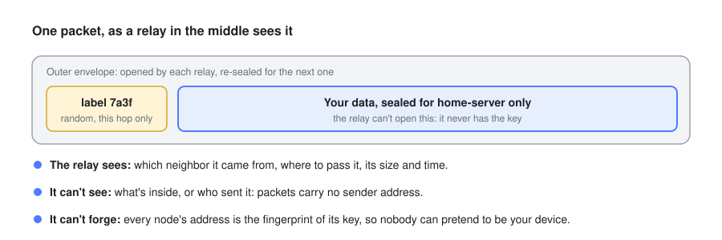
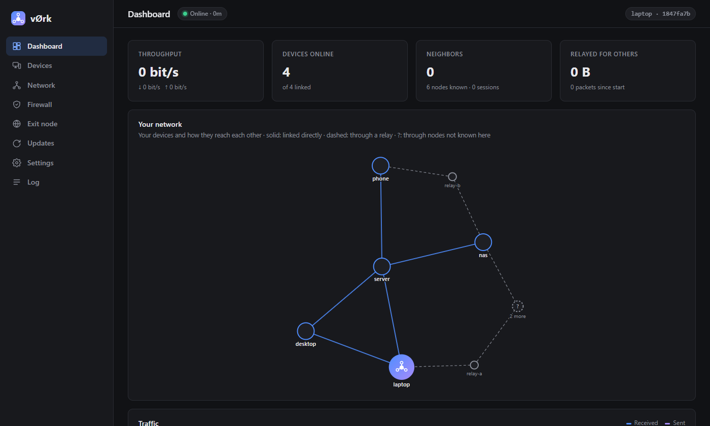
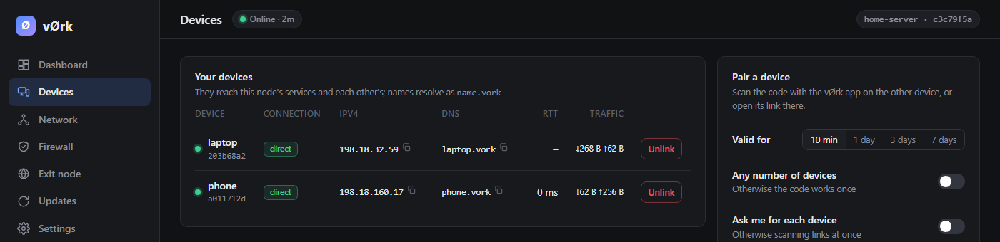
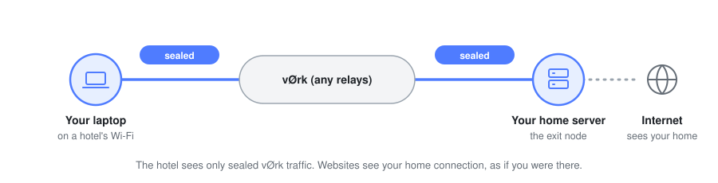

# vØrk

**Your own private network between your devices: no account, no company in the middle.**

vØrk (say "vurk"; written `vork` wherever the `Ø` won't fit) connects your laptop, phone, home server and desktop so they can reach each other from anywhere, as if they were on the same home network. You get names like `laptop.vork`, you can send your internet traffic out through home when you're on someone else's Wi-Fi, and nothing outside your own devices can get in.

It does what Tailscale and similar tools do, without their coordination server. There is no sign-up and no central server that could go down, be shut off, or be told who talks to whom. Your devices find each other through one shared network of vØrk nodes, and everything they send is sealed so that only the receiving device can open it.

> [!WARNING]
> **vØrk is an early prototype.** It runs every day on the author's own machines, but the wire format still changes between versions and nothing has been audited. Try it if you're curious. Don't rely on it for anything important yet.

<p align="center"></p>

## What you can do with it

- **Reach your own devices from anywhere.** Open your home server's files, SSH to your desktop, or check a camera from your phone on mobile data with `home-server.vork`. It works behind home routers and mobile networks, with no port forwarding needed on every device.
- **Use your home internet when you're away.** Turn on an *exit node* at home, and on hotel or café Wi-Fi your laptop and phone send all their internet traffic through it. The local network sees only sealed traffic.
- **Keep everything else out.** Only your linked devices can reach your devices' services. A stranger's node can carry your traffic but can't open a connection to you. If you want to share one thing, for example a game server with a friend, you open that one port, for everyone or for one friend's device.
- **Run without anyone's permission.** No accounts, no licence server, nobody to ask. If one node disappears, the network routes around it.

## How it works, in plain words

**Every device has a key, and its address *is* the key's fingerprint.** A vØrk address looks like `c3c79f5a8859dff3188c4db7d7d9dc7c`. Nobody hands it out and nobody can take it over, because only the holder of the matching key can answer for it. For convenience, your own devices also get a short name (`laptop.vork`) and an ordinary-looking IP address (`198.18.x.x`) that stays the same everywhere.

**Any node can carry traffic for others.** When two of your devices can't reach each other directly (both behind routers, say), their packets travel through other vØrk nodes, called *relays*. A relay forwards packets but can't read them. The packet is an envelope inside an envelope: the outer one is just for the next hop, and the inner one is sealed with [WireGuard](https://www.wireguard.com/) for the final device only.

<p align="center"></p>

**It's always looking for the best route.** A connection runs over two routes at once, through different relays. Each route is measured every second, and a route that stops answering is dropped within seconds. When your devices *can* reach each other directly (on the same Wi-Fi, or a router that cooperates), they switch to a direct link and the relays drop out.

**Your devices form a private garden.** Linking a device is a two-sided agreement (scan a QR code, or approve a request). Linked devices reach each other's services and resolve each other's `.vork` names. Every other node can only carry traffic.

## Getting started

You need at least two devices. One of them should be reachable from the internet: a home server or always-on PC is ideal. vØrk asks your router to open a port by itself (UPnP / NAT-PMP / PCP), which works on most home routers. After that, every other device only needs to find that one.

If your router doesn't do that, forward the node's UDP port on the router by hand: the dashboard's **Settings → Network** shows the port, says whether the router opened it, and lets you choose the port yourself (**Save**, then **Restart now**). Even with no port open anywhere, your devices still reach each other: what can't connect directly goes through relays.

### 1. Install it on each device

Downloads are on the [releases page](https://github.com/vooteleaer/vork/releases):

| On | Take | What it does |
|---|---|---|
| **Windows** 10/11 | `vork-<version>.msi` | installs the node as a service and the vØrk window (its icon waits in the notification area) |
| **Android** | `vork-net-<version>.apk` | the app: the node, the dashboard, a VPN for your apps |
| **Debian 12, Ubuntu 22.04** or newer, elementary OS 7, Linux Mint 21 (x86-64) | `vork_<version>_amd64.deb` | the node as a system service, and the vØrk window |
| **Raspberry Pi OS** (64-bit, bookworm), Debian 12 or Ubuntu 22.04 on ARM64 | `vork_<version>_arm64.deb` | the same, for ARM64 |
| **Any Linux**, older ones too | `vork-linux-x86_64`, `vork-linux-aarch64` | the node alone, one static file: install it as below; its dashboard opens in the browser (`vork web-link`) |
| **Haiku** (x86-64) | `vork-<version>-1-x86_64.hpkg` | the node, started at login; its dashboard in the Deskbar's Applications menu. From 0.3.0 its interface lets programs on Haiku reach your devices at their 198.18 addresses (IPv4 only, as Haiku's network; no `.vork` names there yet); 0.2.0's package has no interface |
| **Home Assistant** (OS or Supervised) | the add-on repository [`vork-home-assistant`](https://github.com/vooteleaer/vork-home-assistant) | Home Assistant as one of your devices: `http://homeassistant.vork:8123` from anywhere |
| **A NAS or server with Docker** (TrueNAS SCALE: Apps → Install via YAML) | [`packaging/docker/node.yaml`](packaging/docker/node.yaml) | the node in one small container, its dashboard on port 30742; the NAS's apps become reachable from your devices at `nas-name.vork:<port>` |

Once it runs, the dashboard's **Updates** page tells you when a newer release is out.

<details>
<summary>Building from source instead, with <a href="https://rustup.rs/">Rust</a></summary>

```sh
git clone https://github.com/vooteleaer/vork
cd vork
cargo build --release          # the program is target/release/vork (vork.exe on Windows)
```

The installers are built by `packaging/windows/build-msi.ps1` (WiX 5), `packaging/deb/build-in-docker.sh` and `clients/android/build-apk.ps1`.
</details>

**Linux without the package** (the bare binary, as root):

```sh
install -m 755 vork-linux-x86_64 /usr/local/bin/vork
vork init --tun vork0          # creates /etc/vork/vork.toml and this machine's key
curl -fsSLo /etc/systemd/system/vork.service https://raw.githubusercontent.com/vooteleaer/vork/main/packaging/vork.service
systemctl daemon-reload && systemctl enable --now vork
vork status
```

`--tun vork0` turns on the network interface, so that ordinary programs can use vØrk addresses and `.vork` names.

**Android:** the app runs vØrk as a VPN. It shows the same dashboard as the desktop (its pages in a menu at the top), can scan pairing codes and use an exit node.

### 2. Link your devices

On the first device (say, the home server):

```sh
vork link-code
```

It prints a QR code and a link like `vork-link:c3c7…?c=…&n=home-server&a=…`. The link carries everything the other device needs to find this one. It's good for 10 minutes and one device, unless you ask for more (`--for 1d`, `--uses 0` for any number, `--approve` to confirm each device yourself).

On the other device, scan the QR code with the Android app, or paste the link:

```sh
vork link 'vork-link:c3c7…'
```

That's it: the two are now each other's devices. To link without a code, run `vork link <address>`. The other side then sees a request (`vork requests`) and decides (`vork allow` / `vork dismiss`). `vork unlink` undoes a link.

If the new device can't reach the one that made the link (it's elsewhere, behind a router with no open port), give it a connection first: in its dashboard, **Settings → Connections**, add `host:port` of a node of yours that is reachable from the internet (the one with an open port), then use the link again.

#### Public nodes to start from

If none of your own nodes is reachable from the internet yet, you can start from a public one: add it under **Settings → Connections** (or `peers` in `vork.toml`). It only helps your devices find each other and relays for them; it can't read your traffic or reach your devices' services, and nothing joins it unless you add it.

| Node |
|---|
| `88.196.217.196:51821` |

Once your devices are linked and reach each other, you can remove it.

> [!TIP]
> Your devices are one group: link a new device to any one of them and it's linked to all of them. A phone linked to the home server sees the laptop that was linked there before, and the laptop sees the phone. Unlinking a device on any of them unlinks it everywhere.

### 3. Use it

Your devices now reach each other by name, from anywhere:

```sh
ping home-server.vork
ssh me@desktop.vork
http://home-server.vork:8080      # in a browser
```

Each device also has a fixed IPv4 address in `198.18.0.0/16` (shown in the dashboard and in `vork status`) for programs that can't use names or IPv6.

## The dashboard

On a **Windows or Linux desktop**, the dashboard is an app: `vork-net` (in [`clients/net-desktop`](clients/net-desktop)) opens it in a window of its own and keeps an icon in the tray. It talks to the node on the same machine directly, so there's nothing to set up. On Linux, a user other than root manages the node once its `vork.toml` names them: `operators = ["alice"]`.

On a **server without a screen**, the node can serve the same dashboard over the network. Add `web = "0.0.0.0:8742"` to `vork.toml`, restart, and run:

```sh
vork web-link
```

It prints a private link to open in your browser. The dashboard uses its own certificate, so the browser asks once; `vork web-link` shows the fingerprint to compare it with.

<p align="center"></p>

It shows traffic, connections and the log, and lets you pair devices, open firewall ports, choose an exit node and check for updates:

<p align="center"></p>

## Exit node: browse safely on someone else's Wi-Fi

<p align="center"></p>

On a **Linux** device that should be the exit (with the `tun` line on), add to `vork.toml`:

```toml
exit = true
```

On the devices that should use it:

```toml
exit_via = "auto"        # the fastest of your devices that offers itself as an exit
```

The Android app has a switch for the same thing, and on Windows the dashboard's Exit node page. Windows and Android send all their internet traffic and name lookups through the exit while it answers; your local network (other devices at home, a printer) stays reachable directly. If the exit stops answering, your device goes back to its normal connection instead of cutting you off. By default, devices using the exit reach the internet only, not the exit's home network. `exit_lan = true` on the exit lets them in there too. Today the exit carries IPv4 traffic, and a Linux device can be an exit but can't use one yet.

## The firewall

Out of the box, **only your own linked devices can reach a device's services.** That's the whole firewall. Relaying traffic for others is never affected. To let other vØrk nodes in, add rules to `allow` in `vork.toml`, or use the dashboard's Firewall page:

```toml
allow = [
  "tcp/80",                                         # a web server, for every vØrk node
  "udp/27015 from 9e1f0c2b7d6a45e38f1b2c3d4e5f6a7b", # a game server, for one friend's device
  "icmp",                                           # answer pings
]
```

A rule for one node always uses its full 32-digit address, since that can't be faked. The dashboard also lists recent blocked attempts, and one click turns one into a rule.

## Updates

The dashboard's **Updates** page shows the latest release on GitHub, what's new in it, and when it's newer than yours, the file for your device to download and install over the old one. Your settings and devices stay.

For your own builds, vØrk can also update itself with releases you sign with your own key. One of your nodes holds the releases, and the others fetch, check and install them. This is currently meant for people building their own releases; see [ADR-0028](docs/adr/0028-self-updating.md) and the `update_*` settings in `vork.toml`.

## How it compares

|  | vØrk | Tailscale and similar | A classic VPN |
|---|---|---|---|
| Account needed | no | yes | depends |
| Central server | none | coordination server | the VPN server |
| Devices behind routers reach each other | yes, through relays or directly | yes | only via the server |
| Who can read your traffic | only the receiving device | only the receiving device | the VPN server |
| Who decides who's in your network | you, device by device | the account and its admin | the server's admin |
| Maturity | **early prototype** | mature | mature |

## Privacy: what others can and can't see

- **Relays** see that a packet passes through them, its size and its timing. When a route is opened, they learn which device it goes to, but not who opened it: packets carry no sender address. They can't read anything, and they can't pretend to be one of your devices.
- **Your devices** know each other's addresses. When two of them link directly, they also learn each other's IP addresses. That's the point of linking, so direct links with strangers are off unless you turn them on.
- **The network** learns that your device's address exists (it announces itself so it can be found). You can stay unannounced and still reach others.
- **Stronger anonymity**, where no single relay knows both ends, is planned but not built.

The full analysis is in the [threat model](docs/03-threat-model.md).

## Status and known limits

- Prototype: the protocol and file formats will change, and nodes of different versions may stop understanding each other. Keep your devices on the same version.
- Releases are pre-releases: no macOS or iOS yet; on Haiku the interface is IPv4 only (from 0.3.0) and there is no local network discovery, and updating is by downloading the new release.
- An exit node must be Linux; Windows and Android can use one, Linux not yet.
- To get started, you need one device that's reachable from the internet (or two on the same network: vØrk finds neighbors on the local network by itself).
- Large networks: route announcements are flooded to everyone today. That's fine for many nodes, but not for millions.
- No per-relay bandwidth limits yet.

What's next is in the [roadmap](docs/04-roadmap.md).

## For developers

- [Technical overview](docs/technical-overview.md): the protocol layers, paths, test results and throughput measurements.
- [Documentation](docs/README.md): vision, architecture, wire format, threat model, roadmap, open questions, and the design decisions (ADRs).
- [Local API](docs/06-local-api.md): how applications talk to the node on their machine.

## License

[MIT](LICENSE)
